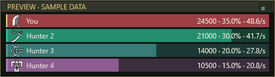

# Iceborn Damage Meter
[](https://ko-fi.com/imkyril)

A compact, in-process damage meter for **Monster Hunter World: Iceborne** on
Windows x64. No separate overlay application or translation service is required.



**GitHub beta: 0.6.17.** Download the standard Windows ZIP for new installations and updates from the [release page](https://github.com/EnzoAlzueta/IcebornDamageMeter/releases/tag/v0.6.17).
The mod is also available on [Nexus Mods](https://www.nexusmods.com/monsterhunterworld/mods/8969).
This repository contains the source code and developer tools.
The interface supports 13 languages. This remains experimental pre-1.0 software
with limited field coverage.

**Version 0.6.17.** Keeps the compact meter one line per hunter
down to width 260. Settings also keep each option and its controls on one line. Uses official localized quest names/objectives, including
Simplified Chinese and a distinct Latin American Spanish game-text variant.
Generic investigations retain their translated label without a guessed target.
It also improves history persistence and keeps sampling when rendering stops.

**Changes since 0.6.11-r2:** removes in-game chat sending; the manual
clipboard action remains available. Includes saved settings to hide the DM shortcut
and use manual panel visibility. With the panel and shortcut hidden, GPU drawing
is skipped; recording continues. It also includes an optional cumulative binary hunt archive
for a future external analyzer. The UI still keeps ten hunts. Storage is handled
in the background with bounded memory and startup reads; no historical analysis
runs in-game. See [archive format and operation](docs/HUNT-ARCHIVE.md). This
update has fifty passing local tests and limited DX12 gameplay evidence: one
four-player hunt and independently verified recent/cumulative files. See the
validation record for the scope of testing. Existing users can use the
update-plugin-only ZIP to preserve their loader, configuration and saved hunts.

[Installation](packaging/INSTALL.md) · [Español](packaging/INSTALL.es.md) ·
[Compatibility](docs/COMPATIBILITY.md) · [Validation](docs/VALIDATION.md) ·
[Build](docs/BUILDING.md) · [Changelog](CHANGELOG.md)

## Features

- Player damage, team share and observed DPS, with native weapon icons.
- Compact panel, live details, last hunt and ten-hunt history.
- Mission names/objectives when available; generic investigations labeled clearly.
- Scale 40–175%, width 260–640, opacity, visible rows and configurable controls.
- Copy the current mission damage summary to the clipboard on request.
- Automatic game-language detection, with offline translations in English,
  Spanish, Portuguese, French, German, Italian, Japanese, Korean, Simplified and
  Traditional Chinese, Russian, Polish and Arabic.

## Install

Close the game and open its local files from Steam.

| Setup | Package and files |
|---|---|
| No loader | Normal ZIP: nativePC + xinput9_1_0.dll |
| Stracker | Normal ZIP: only nativePC |

Use the same standard ZIP to install or update. If the meter already works,
replace only `nativePC/plugins/iceborne_damage_meter.dll` from the ZIP and keep
your loader, INI and saved hunts. See [the installation guide](packaging/INSTALL.md)
for complete language settings, updates, removal and troubleshooting.

## Default controls

| Key | Action |
|---|---|
| F8 | Show/hide |
| Ctrl+F8 | Synthetic preview |
| Ctrl+F6 | Menu |
| F6 | Settings |
| F7 | History |
| Ctrl+F9 | Unlock/lock dragging |

Existing key bindings are preserved.

## Requirements and limits

Windows 10/11 x64, DirectX 11 or 12, SDR and the supported executable for memory
profile 421810. Unsupported executable hashes disable damage reading.

**Expedition and Guiding Lands damage are not supported.** Those contexts show
no data rather than reusing a previous mission. Multi-target quests show mission
totals, not per-monster attribution. Investigations sharing generic ID 30000 are
excluded from personal DPS comparisons. Official game text covers 512 installed
PC quest IDs; legacy entries without matching game text retain English fallback.
Unknown custom quests remain numbered. See [text provenance](assets/quest_text/README.md).

DPS excludes damage already present at first observation and includes time spent
present, including pauses and travel. It is not active attack time or a normalized
skill score. See [statistics](docs/METRICS.md).

The author and a friend tested 0.6.11 in-game and reported no further crashes.
The release reduces repeated DX11 UI raster work, suspends drawing on focus loss
or minimize and adds graphics diagnostics. The original ERR12 cause is not
confirmed. Not every language, party size, GPU or loader combination has been
independently validated.

## Build and contribute

```powershell
powershell -NoProfile -ExecutionPolicy Bypass -File .\build.ps1
```

Requires Visual Studio 2022 or newer C++ Build Tools, Windows SDK, CMake and Ninja.
Use `-SkipGraphics` for non-graphics CI. Local DX11/DX12 tests are separate from
real-game tests. GitHub Actions runs the non-graphics build and tests; check its
actual run result before treating a commit as verified by hosted CI.
See [BUILDING](docs/BUILDING.md), [CONTRIBUTING](CONTRIBUTING.md) and
[localization](locales/README.md). Use English for primary project material;
Spanish companion guides use `.es.md` filenames.

Counters are sampled at 4 Hz, text/composition are cached, and persistence uses
a background worker. History/player storage is bounded. No measured performance
claim applies universally to other systems.

## License and notices

Original project code is MIT; see [LICENSE](LICENSE). Dependencies and technical
references are listed in [THIRD_PARTY.md](THIRD_PARTY.md). Extracted weapon artwork
and official quest text are copyright CAPCOM and separate from the code license; attribution does not
grant additional redistribution rights. No third-party loaders,
full game atlases or extraction tools are bundled. The bootstrap is original
project code, not a copy of a loader or Microsoft's XInput DLL.

## AI disclosure

OpenAI Codex was used to generate and revise code, interface translations,
documentation, mod-page text and HTML/CSS promotional layouts. The author directed
features and adjustments and tested the mod in-game with another player.
UI preview images are diagnostic renders with labeled sample data, not generated
gameplay screenshots. Original CAPCOM weapon icons and official game quest text
are not AI-generated artwork or AI translations.
